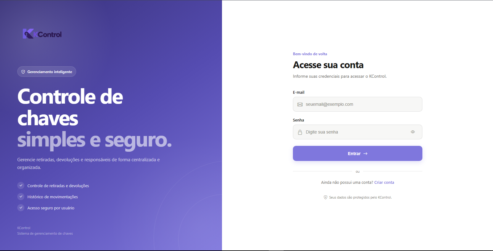
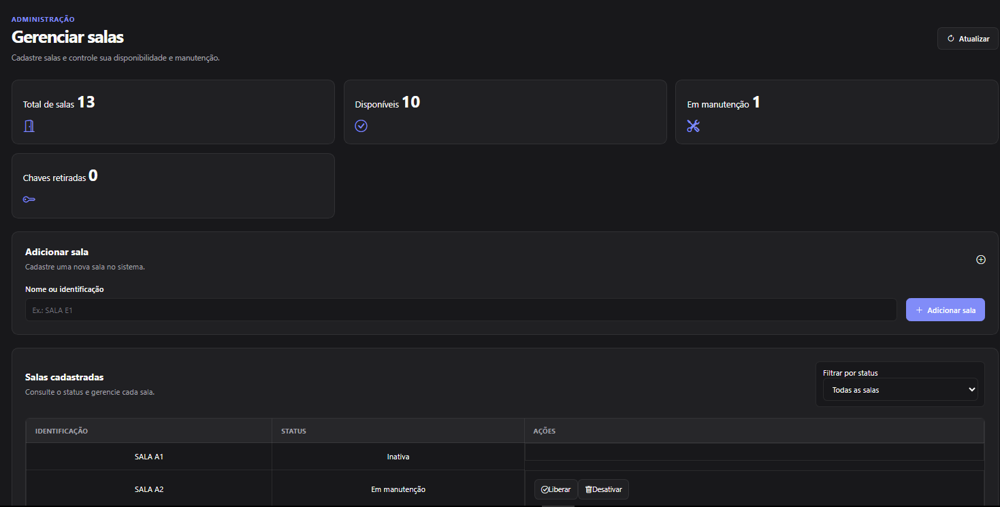
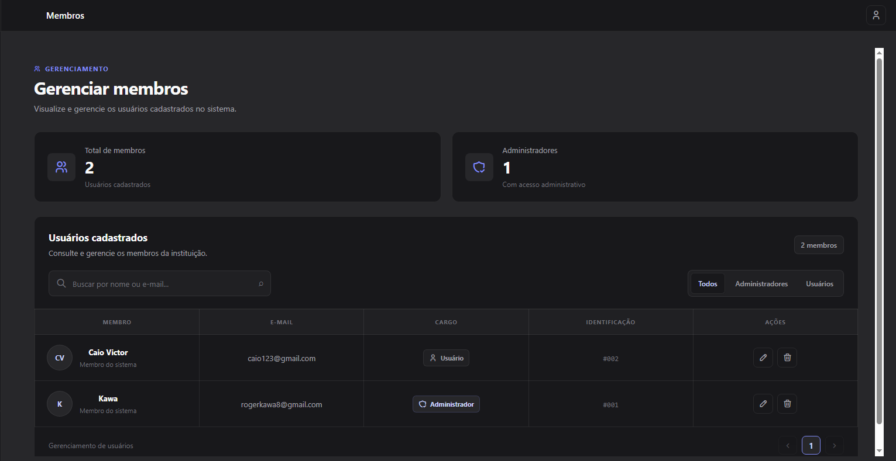
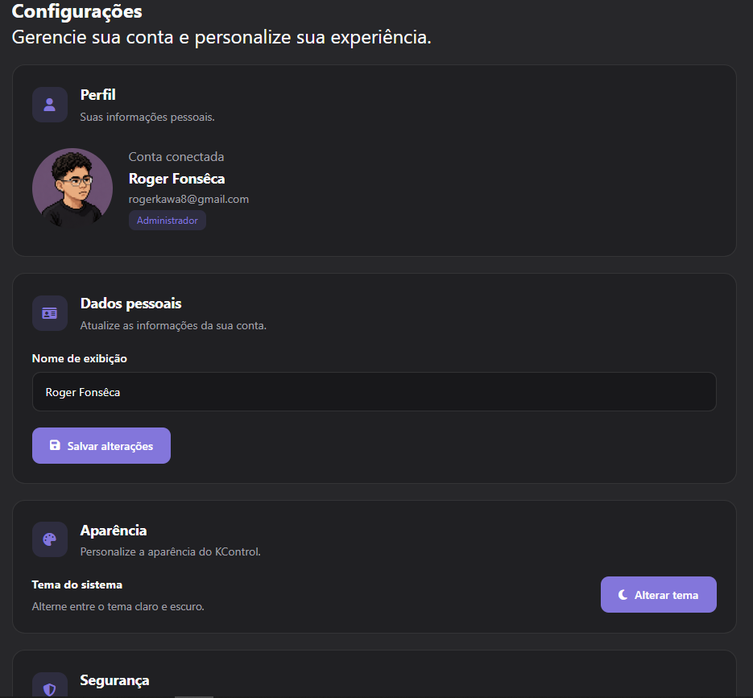

# KControl V2.1

<p align="center">
  
</p>

<p align="center">
  <strong>Gestão de chaves, salas e registros em um só lugar.</strong>
</p>

<p align="center">
  Sistema web para organizar a retirada e a devolução de chaves, acompanhar registros e administrar salas, setores e usuários.
</p>

---

## 📌 Sobre o projeto

O **KControl V2.1** foi desenvolvido para facilitar o controle de chaves e o gerenciamento de salas em ambientes institucionais. A proposta é substituir controles manuais dispersos por um sistema centralizado, com registros organizados e acesso conforme o perfil do usuário.

## 🖥️ Telas do sistema

### Login
<p align="center">
  
</p>

### Gerenciamento de salas
<p align="center">
  
</p>

### Gerenciamento de membros
<p align="center">
  
</p>

### Configurações
<p align="center">
  
</p>

## ✨ Funcionalidades

- **Autenticação de usuários** com controle de acesso por perfil.
- **Registro de retirada e devolução de chaves**, com informações de responsável, setor, sala, turno e horários.
- **Acompanhamento de registros** e consulta ao histórico de movimentações.
- **Gerenciamento de salas**, incluindo organização e status.
- **Gerenciamento de setores** para identificar a área de trabalho relacionada ao registro.
- **Administração de membros** e visualização dos usuários cadastrados.
- **Perfil do usuário**, incluindo atualização de avatar.
- **Dashboard** para visualizar informações e indicadores do sistema.
- **Interface adaptável** e opções de personalização visual.

## 🧰 Tecnologias

### Front-end
- HTML5
- CSS3
- JavaScript
- Bootstrap Icons
- Chart.js
- SweetAlert2

### Back-end
- Node.js
- Express
- MySQL2 / MySQL
- JSON Web Token (JWT)
- bcrypt
- dotenv
- Multer e Cloudinary para imagens de perfil

## 🗂️ Estrutura do projeto

```text
KControlV2.1/
└── KControlV2-main/
    ├── backend/
    │   ├── src/
    │   │   ├── config/
    │   │   ├── controllers/
    │   │   ├── middlewares/
    │   │   ├── models/
    │   │   ├── routes/
    │   │   └── server.js
    │   └── package.json
    └── frontend/
        └── src/
            ├── assets/
            ├── pages/
            ├── scripts/
            ├── styles/
            └── index.html
```

## ⚙️ Como executar localmente

### Pré-requisitos

- Node.js e npm instalados.
- Uma instância MySQL disponível.
- Credenciais e variáveis de ambiente configuradas para o back-end.

### 1. Clone o repositório

```bash
git clone https://github.com/rogerkawa/KControlV2.1.git
cd KControlV2.1/KControlV2-main
```

### 2. Configure o back-end

```bash
cd backend
npm install
```

Crie um arquivo `.env` na pasta `backend` com as variáveis exigidas pela configuração do banco e pelo servidor. **Não envie esse arquivo ao GitHub**, pois ele pode conter senhas, tokens e outras credenciais.

Inicie o servidor de desenvolvimento:

```bash
npm run dev
```

### 3. Abra o front-end

Abra `frontend/src/index.html` usando um servidor estático local (por exemplo, a extensão Live Server do VS Code). Verifique se a URL da API configurada no front-end aponta para o endereço do back-end que está em execução.

> A estrutura e as variáveis de ambiente podem precisar ser ajustadas conforme o ambiente de desenvolvimento utilizado.

## 🔐 Segurança

- Mantenha senhas, tokens e credenciais fora do código versionado.
- Configure as permissões de acesso também no back-end, e não apenas ocultando elementos da interface.
- Em ambientes de produção, utilize HTTPS e credenciais fortes para o banco de dados.

## 🚀 Melhorias futuras

- Relatórios exportáveis de movimentações.
- Filtros avançados por período, sala, setor, turno e responsável.
- Notificações para pendências de devolução.
- Registro de auditoria para ações administrativas.
- Melhorias contínuas de acessibilidade e experiência em dispositivos móveis.

## 👨‍💻 Desenvolvimento

Projeto desenvolvido como solução para tornar o controle de chaves e salas mais organizado, rastreável e prático.

---

<p align="center">
  <sub>KControl V2.1 · Organização e controle em um só sistema.</sub>
</p>
